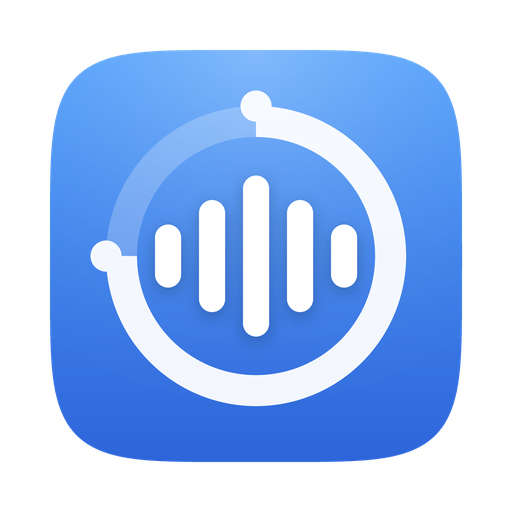
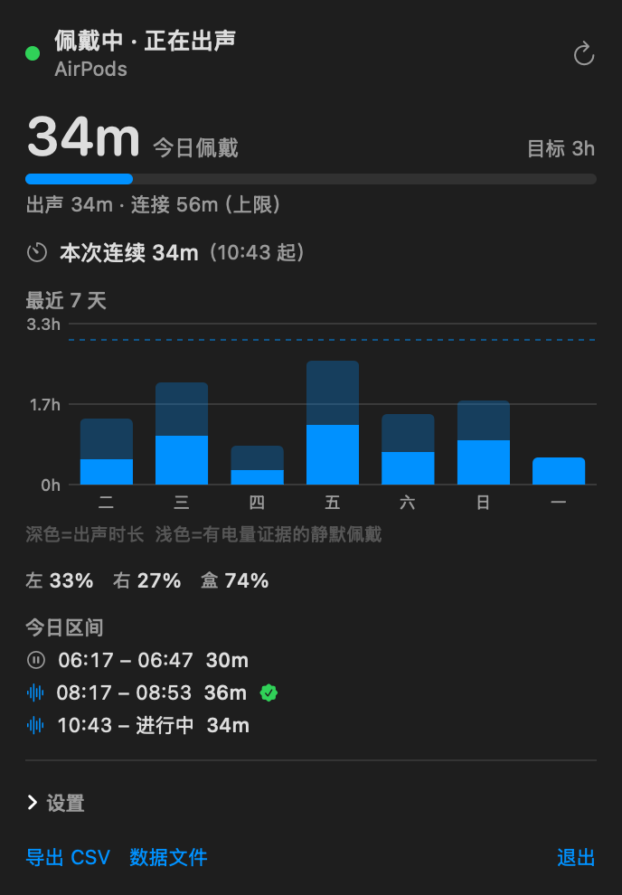
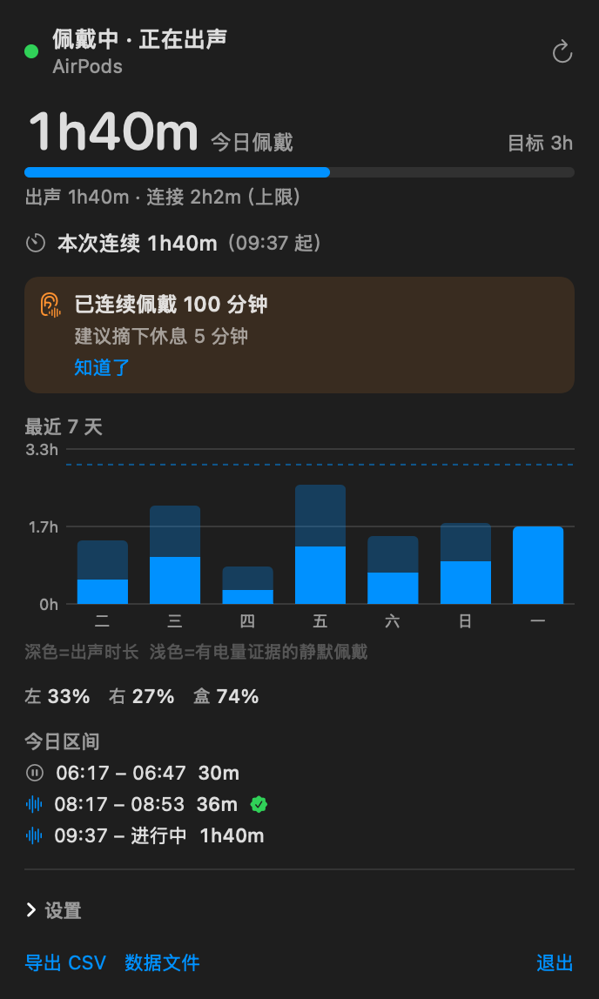

# AirWear



> macOS 菜单栏小工具：**记录 AirPods 的佩戴时间**，连续戴太久时提醒你摘下来歇一会儿。



---

## 安装

**要求：macOS 13+（Apple Silicon 或 Intel 均可）。**

### 方式一：一行命令（推荐）

1. 到 [Releases](../../releases) 页面下载 `AirWear-x.y.z.zip`
2. 打开「终端」，执行：

```bash
unzip -q -o ~/Downloads/AirWear-0.1.0.zip -d /Applications && \
xattr -dr com.apple.quarantine /Applications/AirWear.app && \
open /Applications/AirWear.app
```

三步分别是：解压到 `/Applications` → 抹掉隔离标记 → 启动。不需要 sudo，不装后台服务。

> 仓库里的 [`install.sh`](install.sh) 做的是同一件事，但带注释、可以逐行读完再跑。
> 如果你已经 clone 了仓库，用 `bash install.sh` 更放心（朋友通常没有这个文件，把上面三行直接发给他即可）。

### 方式二：DMG（图形界面）

1. 到 [Releases](../../releases) 页面下载 `.dmg`，双击挂载
2. 把 `AirWear` 拖进 `Applications`
3. **首次打开：右键点 AirWear → 打开**（只需一次，之后系统会记住）
   - macOS 15+ 上如果双击被拦了：系统设置 → 隐私与安全性 → 「仍要打开」

### 方式三：自己编译

需要 Xcode Command Line Tools（`xcode-select --install`）。**本地编译出来的 App 不带隔离标记，零警告。**

```bash
git clone https://github.com/luketebo/AirWear.git
cd AirWear
make install     # 编译 → 装到 /Applications → 启动
```

---

## 用起来是什么样

### 菜单栏

菜单栏直接显示今日佩戴时长（如 `3h12m`）。点开弹窗能看到：

- **状态**：`佩戴中 · 正在出声`（绿）/ `已连接 · 未出声`（橙）/ `未连接`（灰）
- **今日佩戴**（估算）+ 出声 / 连接（上限）拆分 + 目标进度条
- **本次连续佩戴**计时，超过阈值弹出橙色「建议摘下休息 5 分钟」横幅
- **最近 7 天**柱状图（深色 = 出声，浅色 = 电量确认的静默佩戴，虚线 = 每日目标）
- **电量**：左右耳 + 充电盒，以及当前区间的变化（如 `左 33%→29%`）
- **今日区间明细**，✅ 表示这一段有电量佐证
- 底部可切换**外观**（跟随系统 / 浅色 / 深色），或**打开主窗口**

### 主窗口

点弹窗底部的 **「打开主窗口」**。这是菜单栏应用的唯一入口（它不占 Dock 图标）。
里面分三个页签：

| 页签 | 内容 |
|---|---|
| **概览** | 顶部切「周 / 月 / 年」，显示该时段的佩戴总计与趋势图（年视图按月聚合） |
| **历史** | 该时段内逐段佩戴记录，正在进行的那段会标「进行中」 |
| **设置** | 外观模式、只统计 AirPods、静默是否算佩戴、久戴通知、阈值与每日目标 |

在概览 / 历史页，**用触控板左右滑动**可以翻到上一个或下一个时段（只能往前翻到有记录的时段，
且不会和纵向滚动打架）。



> **桌面小组件**（小/中两种尺寸）代码已完成，但**尚未验证能否出现在小组件画廊**，详见 [docs/widget.md](docs/widget.md)。
> 它不影响主 App 的任何功能。

---

## 命令行


| 命令                                  | 作用                                   |
| --------------------------------------- | ---------------------------------------- |
| `make dump`                           | 当前音频设备 + 判定状态 + AirPods 电量 |
| `make watch SECONDS=60`               | 前台监听，实时打印状态变化             |
| `make today` / `make week`            | 今日 / 最近 7 天统计                   |
| `make export F=~/Desktop/airwear.csv` | 导出区间数据为 CSV                     |
| `make log`                            | 查看运行日志                           |
| `make autostart` / `make unautostart` | 开机自启（LaunchAgent）                |

---

## 已知限制

1. 基于 `runningSomewhere` 的判断无法区分「戴在耳朵上播」和「耳机放桌上播」——但后者本来也少。
2. 电量粒度 1%，短于十几分钟的静默佩戴拿不到电量证据，只能算进「连接（上限）」。
3. 只统计当前这一副设备（AirPods 优先）。同时连两副耳机时不做并行统计。
4. 久戴提醒走 `osascript`，通知来源会显示成「脚本编辑器」而不是 AirWear（换来零权限、零签名依赖）。
5. 菜单栏文字能否显示取决于 `MenuBarExtra` 的 `Label` 渲染。若只看到图标看不到时长，
   把 `Sources/AirWear/AirWearApp.swift` 里的 `Label(...)` 换成 `Text(model.menuBarTitle)` 即可。

---

## 项目结构

```
Sources/
├── AirWear/             主程序
│   ├── CoreAudio.swift      CoreAudio 薄封装 + 蓝牙输出设备识别
│   ├── WearMonitor.swift    三层信号状态机（去抖、睡眠、电量佐证）
│   ├── BatteryProbe.swift   system_profiler 电量解析 + 放电推断
│   ├── SessionStore.swift   区间存储（原子重写 + flock + 合并 + 统计 + CSV）
│   ├── MenuBarView.swift    AppModel + 弹窗 UI（Swift Charts）
│   ├── MainWindow.swift     主窗口：概览 / 历史 / 设置 三页签（Swift Charts）
│   ├── PeriodSwipeHandler.swift  触控板横向滑动 → 切换统计时段
│   ├── AirWearApp.swift     MenuBarExtra + Window 入口
│   ├── CLI.swift            --dump/--watch/--today/--week/--export/--render…
│   ├── Settings.swift       UserDefaults 偏好（含外观模式）
│   ├── Format.swift         时长/日期格式化
│   └── Logger.swift         日志（stdout + 文件，自动截断）
├── AirWearWidget/       桌面小组件扩展
└── Shared/              两个目标共用的路径与数据桥
Resources/                 Info.plist、AppIcon.icns、entitlements、LaunchAgent 模板
scripts/
├── make-icon.py             生成 App 图标
└── widget-doctor.sh         小组件可见性排查
docs/                      深度文档 + 截图
```

## 开发

```bash
make build      # 编译并组装 AirWear.app
make run        # 编译 + 启动（开发用）
make install    # 装到 /Applications（并清掉工作区副本，避免同 bundle id 双份）
make today      # 命令行看今日统计
make icon       # 重新生成图标（需 pip install pillow numpy）
make clean
```

## 数据位置

- `~/Library/Application Support/AirWear/sessions.sqlite3` —— SQLite 区间数据库（首次启动从旧 `sessions.json` 导入）
- `~/Library/Logs/AirWear/AirWear.log` —— 运行日志

卸载：`rm -rf /Applications/AirWear.app`，数据目录删掉即彻底清除记录。

## License

[MIT](LICENSE)
